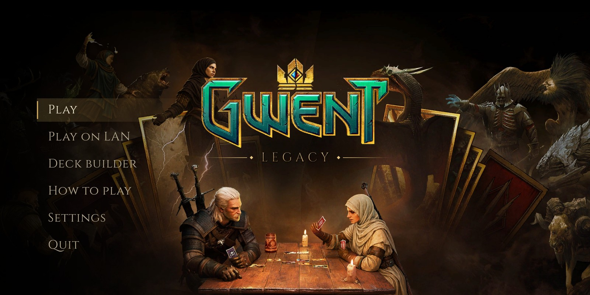
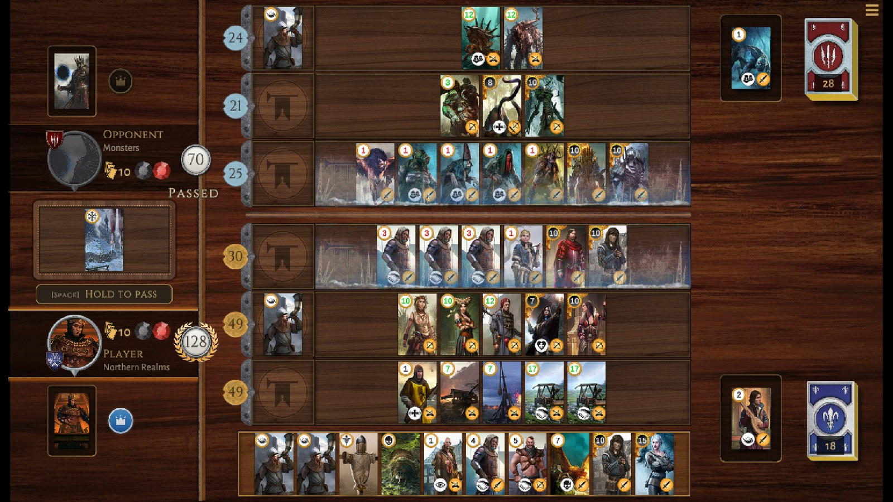
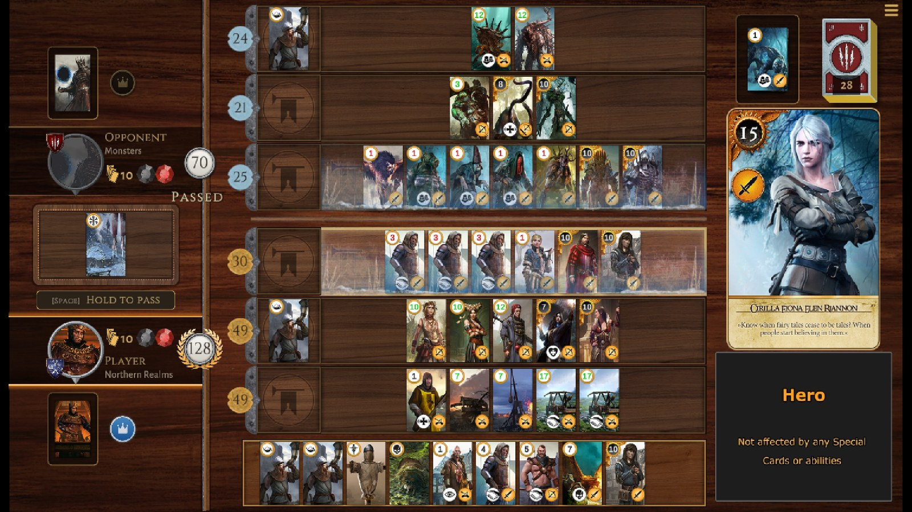
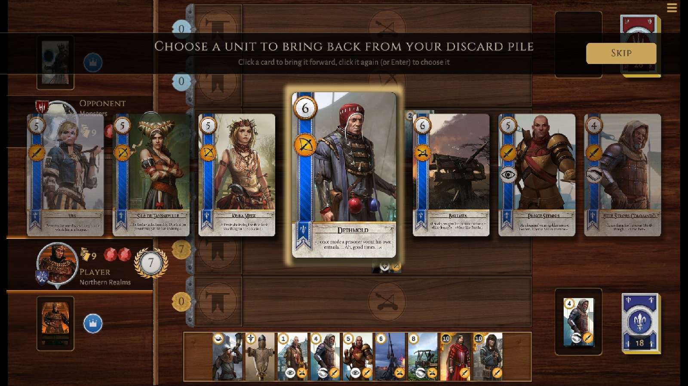
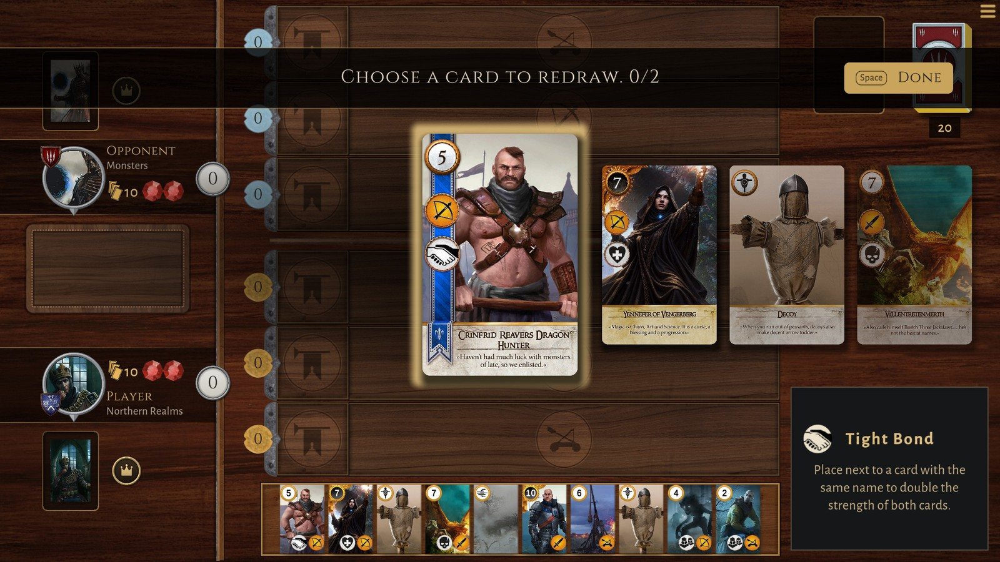
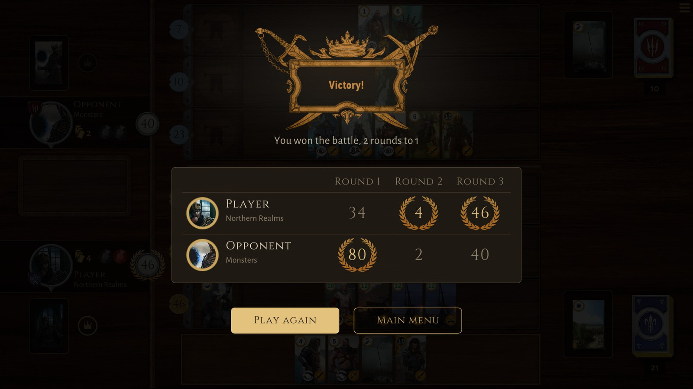
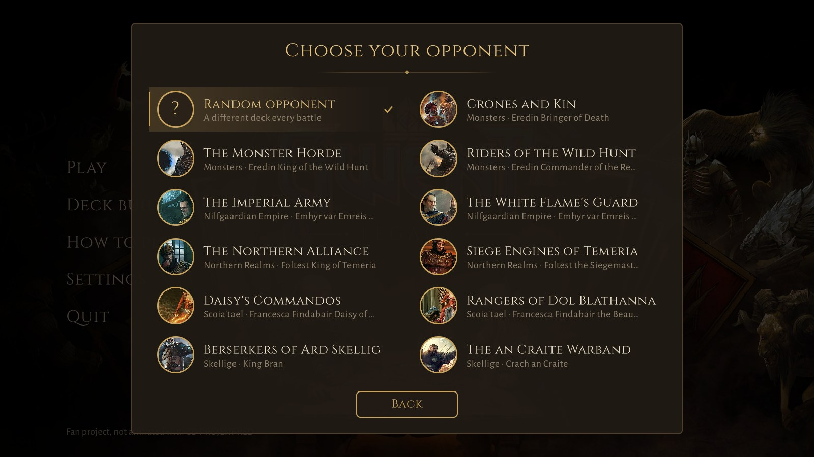
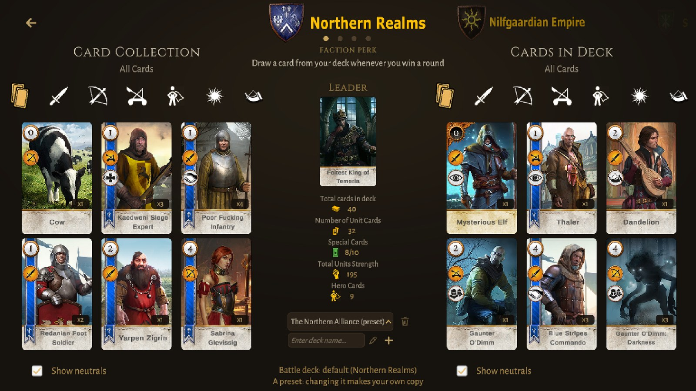

# GwentUnityClone

<p align="center">
  
</p>

 Gwent, the card game of The Witcher 3: Wild Hunt (the original in-game version, not the standalone Gwent), remade in Unity for Windows and Android.

## About this project

This is a fan remake of Gwent, the famous card game of The Witcher 3.
I'm aware that CD PROJEKT RED made an official standalone Gwent, but it plays very differently. I'm enthusiastic about the original version and its mechanics, which is one of the reasons I got so immersed in the world of The Witcher 3. So here it is, made nearly from scratch in the Unity game engine.

The card art comes from [matt77hias/Gwent](https://github.com/matt77hias/Gwent), which also explains the rules if you're new to the game.

I made the original interface in Adobe Photoshop. Today most of it is drawn by the game's own sprite generator, next to some of The Witcher 3's own interface art and a few free assets (see [Credits](#credits)).

The rules follow The Witcher 3's Gwent closely and are covered by automated tests (see [Tests](#tests)).

This game supports full deck editing and has an AI opponent with three difficulties (Easy, Normal, Hard) and 9 decks across the four factions.

Sorry, no multiplayer :/ (yet)

## Screenshots

<h3 align="center">Northern Realms vs Monsters, the deciding round</h3>



<h3 align="center">A card in the spotlight, a medic's choice</h3>

<p align="center">
  
  
</p>

<h3 align="center">The redraw, and the end of the battle</h3>

<p align="center">
  
  
</p>

<h3 align="center">Choosing an opponent, building a deck</h3>

<p align="center">
  
  
</p>

## How to play

| Action                                                                          | Desktop                                                                                                                                                                                                                                                                                                                                                                                                                                           | Android                                                                                                     |
| ------------------------------------------------------------------------------- | ------------------------------------------------------------------------------------------------------------------------------------------------------------------------------------------------------------------------------------------------------------------------------------------------------------------------------------------------------------------------------------------------------------------------------------------------- | ----------------------------------------------------------------------------------------------------------- |
| Start a battle                                                                  | **Play**, then choose your opponent (one of 9 decks across the four factions) or **Random opponent**; the choice is remembered                                                                                                                                                                                                                                                                                                                    | Same, with taps                                                                                             |
| Redraw a card at the start (up to 2)                                            | Click a card in the redraw carousel to bring it forward, click it again (or Enter) to redraw it; arrow keys or the mouse wheel browse. In your hand, a click brings a card forward and a double-click on the front card redraws it (a quick double-click on another card only brings it forward). **Done**, Space or right-click keeps your hand                                                                                                  | Tap a card to bring it forward, tap it again to redraw it, then **Done**                                    |
| Select a card from your hand                                                    | Click it: it goes to the showcase on the right, with its description, while you choose its place (click its empty slot in the hand to put it back). Keyboard: Left/Right (or A/D) go through the hand, Enter takes the card                                                                                                                                                                                                                       | Tap it                                                                                                      |
| Play the selected card                                                          | Click a highlighted row (weather/scorch: the lit weather board, decoy: one of your framed units). The cursor turns gold where the card can go and shows a red "no" where it can't; clicking there plays a warning sound and keeps the card in your hand. Keyboard: Up/Down (or W/S) choose among the places it fits, Enter plays it there (or where it fits, when only one place does); Esc or right-click puts it back                           | Same, with taps (the warning sound, no cursor)                                                              |
| Use your leader                                                                 | Click the leader card or its button: it shows on the right, as a card about to be played, and lights where its ability acts (a row, a horn slot, the weather board, a discard pile). Click it again, or the lit place, to use it; Esc, right-click or another card puts it back. Keyboard: X, then X again or Enter. Its crown is lit blue while the ability can still be used this round (grey once used or after passing); hover it for details | Tap it, then tap it again or the lit place. Hold a finger on the button to see whether it can still be used |
| Browse a discard pile (either side)                                             | Click it: it opens in the card carousel, its top card in front (arrow keys or the wheel browse, Esc or **Close** puts it away)                                                                                                                                                                                                                                                                                                                    | Tap it                                                                                                      |
| Pass (for the rest of the round)                                                | Hold Space, or hold the **Hold to pass** button                                                                                                                                                                                                                                                                                                                                                                                                   | Hold the button                                                                                             |
| Scoia'tael: choose who starts                                                   | **Go first** or **Go second** in the dialog at the start of the battle                                                                                                                                                                                                                                                                                                                                                                            | Tap                                                                                                         |
| After the battle                                                                | The end screen shows The Witcher 3's emblem of the outcome and every round's score; **Play again** or **Main menu**                                                                                                                                                                                                                                                                                                                               | Tap                                                                                                         |
| Pause (resume, settings, give up)                                               | Esc or the menu button at the top right. **Give up** counts as a loss                                                                                                                                                                                                                                                                                                                                                                             | Back button or the menu button                                                                              |
| Choose a card in a picker (medic, leaders, Emhyr's look at the opponent's hand) | The cards show in the carousel under a title, as in the redraw: click a card to bring it forward, click it again (or Enter) to choose it; arrow keys or the wheel browse; Down goes to **Skip** (**Close** for a look)                                                                                                                                                                                                                            | Tap a card to bring it forward, tap it again to choose it                                                   |
| Preview a card (board, hand, weather, discard pile, leaders)                    | Hover it                                                                                                                                                                                                                                                                                                                                                                                                                                          | Hold a finger on it: it shows on the right until you lift the finger (a hand card: tap it to select it)     |
| Deck builder: add/remove a card                                                 | Double-click it. Each card shows once with its count: the copies in the deck, or in the collection the copies left to add (a card whose copies are all in the deck leaves the collection). Tabs: all, close, ranged, siege, heroes, weather, special cards                                                                                                                                                                                        | Tap it                                                                                                      |
| Deck builder: card details                                                      | Right-click                                                                                                                                                                                                                                                                                                                                                                                                                                       | Hold a finger on it                                                                                         |
| Deck builder: presets                                                           | Each faction's AI decks are listed after your own decks, marked "(preset)". Pick one to play with it as it is; your first change saves your own copy ("The Monster Horde (copy)") and the preset stays as it was. Presets can't be renamed or deleted                                                                                                                                                                                             | Same, with taps                                                                                             |
| Settings (audio, display, game speed, difficulty)                               | Main menu or pause menu > **Settings**. **Game > Game speed** (Slow, Normal, Fast) sets how fast cards move, notices pass and the opponent plays. **Game > Difficulty** (Easy, Normal, Hard) sets how well the opponent plays (see [The AI](#the-ai))                                                                                                                                                                                             | Same                                                                                                        |
| Rules of the game                                                               | Main menu > **How to play**: the rules with the game's own pieces (the battle, the board, cards, abilities, special cards, the factions with their perks and leaders, controls); hover a leader to read its ability                                                                                                                                                                                                                               | Same; hold a finger on a leader                                                                             |

The deck you last selected in the deck builder (one of yours or a preset) is used in battle, as long as it is valid (at least 22 unit cards, at most 10 special cards,
and each card at most as many times as The Witcher 3 has copies of it: heroes and most cards once, up to 5 Mahakaman Defenders). The line
at the bottom of the deck builder shows which deck that is. Without a valid deck, the battle uses the built-in Northern Realms deck. A deck
saved with more copies than that loses the extra ones when it is loaded.

## Rules, as in The Witcher 3

- Each turn you do one thing: play a card, use your leader or pass. Playing a card ends your turn. Passing is final for the round:
  the other side keeps playing until it passes too, then the higher total wins the round. A side with no card left and no leader
  ability it could use right now passes automatically, and a side that starts a round with no card in hand sits that round out,
  even with its leader unused.
- The winner of a round starts the next one (after a drawn round, whoever passed last). Scoia'tael decide who starts the battle.
- A leader ability that would do nothing right now (no weather to clear, an enemy row under 10 for a scorch, no matching weather card
  in the deck...) can't be used, so it is never wasted. Passive leaders (The Treacherous, Invader of the North, The White Flame,
  Daisy of the Valley) work from the start; The White Flame cancels the other leader, passive ones included.
- A decoy on a row is not a unit: morale, horns and scorch ignore it, and Monsters never keep it (nor a hero) at the end of a round.
- The Cow summons the Bovine Defense Force when it goes to the discard pile; the Defense Force arrives when the board is cleared for
  the next round, and vanishes instead of going to the discard pile.
- Muster also pulls the matching cards from your hand, not only from your deck (The Witcher 3 does this too, although the card only
  says "deck"). The Arachas Behemoth calls the Arachas and Gaunter O'Dimm calls the Darkness, but not the other way round.
- Francesca, Hope of the Aen Seidhe moves an agile unit when its own strength would be higher on the other row (ranged row first),
  as The Witcher 3 judges it, not when your total would be.
- The Eredin leaders do what their cards say in The Witcher 3 (as the Witcher wiki lists them): Commander of the Red Riders doubles
  your close combat row, Bringer of Death restores a card from your discard pile, Destroyer of Worlds discards 2 cards to draw 1 of
  your choice, King of the Wild Hunt plays any weather card from your deck.

Differences that remain: the Ice Giant is 6 strength as on its card (5 in The Witcher 3), a revived agile unit goes where you put
it (The Witcher 3 puts it on the row where it is stronger), a leader's horn leaves no card in the discard pile, and the Skellige
faction (Blood and Wine) is not in the game.

## The AI

The opponent plays by the same rules as you, at the difficulty set in **Settings > Game**:

- **Easy** plays like a beginner: each turn, the card that adds the most strength right now, round 1 included, so it runs short of
  cards later. A spy is just a weak card to it, now and then it plays a card that is not its best, and it keeps the hand it was dealt.
- **Normal** weighs every move on a copy of the board (weather, horns, morale, bonds, scorch): it plays its spies first, chains its
  medics, saves its cards in a round it can afford to lose, gives up a round it cannot win, and uses its leader when it pays off.
- **Hard** looks ahead. For each move worth considering, it plays the rest of the battle out 24 times, both sides playing as Normal,
  and plays the move that wins most often. It never reads your hand: it knows which cards your deck holds (like a rival who has seen
  it), and for each of those battles deals your hand anew from the cards it has not seen yet. It thinks while the turn's notice shows,
  at most 1.5 seconds a move; a slower device plays out fewer battles, and Hard still beats Normal with a third of them.

Over the 9 decks, every one against every other, Normal beats Easy in about 72% of battles and Hard beats Normal in about 75%.

Each deck's leader suits its cards: the Monster Horde, all close combat, brings fog and rain down on the back rows (King of the Wild
Hunt); the Riders of the Wild Hunt are their own close combat horn (Commander of the Red Riders, so no Dandelion); the Rangers of Dol
Blathanna are archers and agile units under a ranged horn (Francesca the Beautiful).

## Development

Open `GwentCardGame/` with **Unity 6.6 (6000.6.5f1)**. The project was upgraded from 2019.4; the last 2019.4 commit is `a228947`.
Rendering uses the Universal Render Pipeline (URP 17.6, settings in `Assets/Settings`). The game is all UI, so HDR, MSAA, shadows and post-processing are off.

| Folder                                          | What's inside                                                                                                                                                                                                                                                                                                                                                                                                                                     |
| ----------------------------------------------- | ------------------------------------------------------------------------------------------------------------------------------------------------------------------------------------------------------------------------------------------------------------------------------------------------------------------------------------------------------------------------------------------------------------------------------------------------- |
| `Assets/Scripts/Rules`                          | The game rules as plain C# with no Unity dependency (`Gwent.Rules` assembly): card data, strength calculation (weather, tight bond, morale, horns), scorch, muster, medic, agile, rounds, deck validation and the AI's decisions (`AiBrain`, with Hard's look-ahead in `AiSearch` and `BattleSim`)                                                                                                                                                |
| `Assets/Scripts/SceneController.cs`             | The battle: turns, rounds and the board UI, built on top of the rules                                                                                                                                                                                                                                                                                                                                                                             |
| `Assets/Scripts/Battle`                         | The board: `BoardView` draws it from the model, `CardLane` lays out the hand and the rows in The Witcher 3's order, and `BoardPresenter` plays each play as The Witcher 3 does (the showcase, the card gliding in from the board's edge, a hero's fire running around its edge, ability flares, scorch flames, the medic's green sign on the discard pile, cards flying from the deck, a lost round's gem breaking) before the turn passes        |
| `Assets/Scripts/AI`                             | Executes the AI's decisions at the difficulty of the settings (Hard thinks on another thread while the turn's notice shows); always ends its turn, falls back to passing                                                                                                                                                                                                                                                                          |
| `Assets/Scripts/DeckController.cs`, `DeckEdit/` | The deck builder                                                                                                                                                                                                                                                                                                                                                                                                                                  |
| `Assets/Scripts/Utility`                        | Audio, settings, deck files, card database, runtime UI layer (toasts, dialogs, Escape handling), logging                                                                                                                                                                                                                                                                                                                                          |
| `Assets/Scripts/UI`                             | The menus' look: theme (`Resources/UITheme.asset`: fonts, colors, sprites), UI kit (buttons, menu entries, sliders, switches, steppers), settings screen, pause menu                                                                                                                                                                                                                                                                              |
| `Assets/Editor/UISpriteGenerator.cs`            | Draws the UI sprites (`Assets/UI/Sprites`) and the board pieces (`Assets/UI/Board`: portrait frame, card shadow, the glow ring of the battle's highlights, row frames, the rows' emblems shown on empty rows, the table; and `Assets/Resources/UI/Rules`: the How to play page's ability medallions, **Gwent > UI > Regenerate Rules Page Art**; the gems and score discs are The Witcher 3's art): **Gwent > UI > Regenerate Sprites and Theme** |
| `Assets/Resources/Cards`                        | `cards_db.json` (every card's stats, including how many copies The Witcher 3 has of it) and the card images                                                                                                                                                                                                                                                                                                                                       |
| `Assets/Resources/Decks`                        | `player_default.json` (the built-in deck), `__empty__.json`, and the AI's 9 decks in `AI/`                                                                                                                                                                                                                                                                                                                                                        |
| `Assets/Resources/W3`                           | The Witcher 3's interface art: notices' emblems, ability effects, the end of battle emblems (see `CREDITS.md`)                                                                                                                                                                                                                                                                                                                                    |
| `Assets/Tests/EditMode`                         | Unit tests for the rules and the AI's difficulties, and a fuzz test that plays hundreds of random battles                                                                                                                                                                                                                                                                                                                                         |
| `Assets/Editor/GwentAutoplay.cs`                | End-to-end smoke test that plays full battles                                                                                                                                                                                                                                                                                                                                                                                                     |
| `Assets/Editor/GwentMonkey.cs`                  | Monkey test: battles under a storm of random input                                                                                                                                                                                                                                                                                                                                                                                                |

Saved decks live in `Application.persistentDataPath/Decks/<faction>/<file name>.json`, the file name being the deck's name in lower case
with anything unsafe removed (`My Deck!` is `my_deck.json`); settings are saved in `PlayerPrefs`.
Gameplay logging (`GameLog.Info`) only runs in the editor and debug builds (or with the `GWENT_VERBOSE_LOGS` define).

### Release builds

Menu **Gwent > Build > All platforms** (or one platform) builds the game for Linux, Windows, macOS (Intel and Apple Silicon),
Android and the web, each from the same editor, into `GwentCardGame/Builds/<version>/` with archives ready to hand out
(`GwentLegacy-<version>-linux.tar.gz`, `-windows.zip`, `-macos.zip`, `.apk`, `-web.zip`) and `build-report.txt`. A platform
whose build support is not installed (Unity Hub > Installs > Add modules) is skipped. From the command line, with the editor closed:

```bash
Unity -batchmode -projectPath GwentCardGame -executeMethod GwentBuild.BuildAllBatch -buildTargets linux,windows
```

- The Android build is a 64-bit (ARM64) `.apk` to install directly. It is signed with a release key when the environment has
  `GWENT_KEYSTORE` (the keystore file), `GWENT_KEYSTORE_PASS`, `GWENT_KEY_ALIAS` and `GWENT_KEY_PASS`; otherwise with Unity's
  debug key, and a build from another machine then only installs after the old one is removed (which deletes its decks).
- The macOS app is ad-hoc signed by Unity, not notarized: macOS asks once to allow it (System Settings > Privacy & Security >
  Open Anyway). Windows shows "Windows protected your PC" once (More info > Run anyway).
- The web build is compressed with a fallback, so any static host serves it. In a browser Hard thinks a few milliseconds a frame
  (there is no other thread), Quit is gone, the display settings are a Fullscreen switch, and decks are stored in the browser.
- Images are kept to sizes that are multiples of 4 so they compress on every platform (a card at 380x591 would ship uncompressed,
  four times larger).

## Tests

- **Rules unit tests**: Window > General > Test Runner > EditMode > Run All. They include a fuzz test (`RulesFuzzTests`, the harness
  is `RulesFuzzer`): 400 battles between random and absurd decks (all spies, all medics, musters, weather spam, decoys, a handful of
  cards...) making random moves the way the battle does, with every unit's strength checked against an independent copy of The
  Witcher 3's strength formula, and card conservation, scores, horn slots, the weather board, round ends and round winners checked
  after every move; the AI makes some of those moves, at every difficulty. `AiDifficultyTests` play the AI's 9 decks against each
  other: Normal must beat Easy and Hard must beat Normal, no card may be lost or made, and every deck's active leader must come into
  play. `AiBrainTests` check that every difficulty only makes legal moves, and that Hard's move does not depend on which of your
  unseen cards are in your hand.
- **Autoplay smoke test**: menu **Gwent > Run Autoplay Smoke Test** (or Ctrl+Shift+Alt+G). It plays one battle with the default deck and one with a generated deck for every leader, with a random player against the AI (cycling through the AI's 9 decks and its three difficulties), and fails on errors in the log, on a game that stops progressing, on cards appearing or disappearing, or on a board that shows other cards than the game. Parts of it go through real input (a virtual mouse and keyboard at human speed): the redraw (clicks, keys, Space), card selection, holding Space to pass, the pause menu, playing a card with the keyboard, the touch controls (long presses on the leader, its button and a hand card; taps), the game speed and difficulty settings, the card picker's keys, a discard pile opened in the carousel, and choosing then using the leader. Then the deck builder opens on a test deck it made: real clicks add and remove cards (the counts follow, a hero already in the deck is no longer offered, an 11th special is refused), go through the weather and specials tabs, change the leader, switch factions and pick the deck in the dropdown, and its API is checked (presets: picked, never renamed, deleted or changed, an edit saved as a copy; renaming, deleting decks, invalid and corrupt files). Last, the main menu: its settings and How to play, then **Play**, the opponent picker and a battle with the deck chosen in the builder, the fallback to the default deck when the battle deck is invalid, and a preset as the battle deck. The run restores the battle deck, the opponent and the settings it changes. The report is written to `Logs/autoplay-report.txt`.
- **Monkey test**: menu **Gwent > Run Monkey Test** (10 minutes). Battles between random AI decks played under a storm of random input:
  a virtual mouse and keyboard click, double-click, right-click, hold, drag and scroll on whatever the screen offers and mash the
  game's keys and others at any moment (during plays, banners, the redraw, pickers, the pause menu, the end screen), switching the
  touch controls, the game speed and the difficulty now and then; when nothing moves for a while, a random legal move or an Escape keeps it going.
  Fails on errors in the log, cards appearing or disappearing, a board that shows other cards than the game when idle, and a game
  that stops progressing. It restores every setting and deck file it may change. The report is written to `Logs/monkey-report.txt`.
- **Touch controls in the editor**: menu **Gwent > Simulate Touch Controls** plays with the phone's controls using the mouse (a click is a tap, a held click is a finger held on a card).

From the command line (close the project in the editor first), with the [Unity CLI](https://docs.unity.com) signed in (`unity auth`):

```bash
unity test GwentCardGame --mode EditMode --output editmode-results.xml
```

The autoplay test needs the editor to stay open after the method returns, so it runs the editor directly (the CLI's `run` always adds `-quit`):

```bash
<path-to>/6000.6.5f1/Editor/Unity -batchmode -nographics -projectPath GwentCardGame -executeMethod GwentAutoplay.RunBatch -autoplayReport autoplay-report.txt -logFile autoplay.log
```

## AI agents (MCP)

The project includes the experimental `com.unity.pipeline` package, which lets the Unity CLI talk to a running editor.
To use it from an MCP client such as Claude Code, register the CLI's MCP server and open the project in the editor:

```bash
claude mcp add --scope user unity-editor-mcp -- /absolute/path/to/unity mcp
```

`unity status` lists the editors the server can reach.

## Credits

It goes without saying, but I don't claim ownership of the game idea, the card art or any other material from The Witcher 3: Wild Hunt; all credit goes to its owner, CD PROJEKT RED.
This is a non-commercial fan project.

## License

- The source code is released under the [MIT License](LICENSE).
- The license does not cover the Gwent/Witcher card art, names and other CD PROJEKT RED material, which remain the property of their owners.
- The fonts keep their own licenses: Cinzel and Alegreya Sans (SIL Open Font License 1.1), Roboto (Apache 2.0); see `GwentCardGame/Assets/Fonts/FONTS-LICENSE.md`.
- The opponent decks (`Resources/Decks/AI`) are adapted from the default decks of [gwent-classic](https://github.com/asundr/gwent-classic) by Arun Sundaram (MIT with the Commons Clause), as kept in [gwent-classic-v3.1](https://github.com/RandomPianist/gwent-classic-v3.1); three were changed so that their leader suits their cards (see [The AI](#the-ai)).
- The battle's notification emblems, ability flares, end of battle emblems, gems and row-score circles are The Witcher 3's own interface art, as extracted by gwent-classic (see `GwentCardGame/Assets/Resources/W3/CREDITS.md`).
- The table under the board is "Dark Wood" from [Poly Haven](https://polyhaven.com/a/dark_wood) (CC0); see `GwentCardGame/Assets/UI/Board/Sources/CREDITS.md`.
